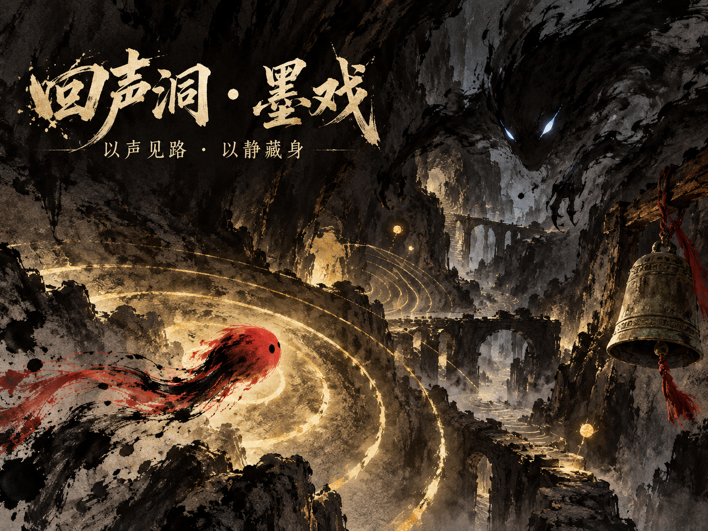

[简体中文](README.zh-CN.md) · [English](README.md) · [日本語](README.ja.md)

# Echo Cavern · Moxi / 回声洞 · 墨戏

## ゲームについて

あなたは、墨色の深みに落ちた一滴の朱。ほとんど光のない洞窟で、足音から広がるこだまは岩壁を照らすと同時に、闇に潜む墨の影を目覚めさせます。

『回声洞 · 墨戏』は、ソナーを使って探索する水墨画風の迷路ゲームです。移動、朱の鈴、ダッシュ、墨石のデコイで道を一時的に浮かび上がらせ、五つの迷宮絵巻に散らばる金色の墨の胞子を集めます。出口となる余白が開いたら、そこから脱出しましょう。墨の影は巡回し、音を聞きつけ、追いかけてきます。音を出すほど道は見やすくなりますが、危険も近づいてきます。手描きの中国水墨画素材、動く墨の表現、五音音階の音楽、自動生成される迷路を組み合わせており、PC やスマートフォンのブラウザーですぐに遊べます。

## オンラインで遊ぶ

- GitHub Pages：<https://hbaopiqi.github.io/echo-cavern-moxi/>
- Sites ミラー：<https://echo-cavern-moxi.hbaopiqi.chatgpt.site>

## 操作方法

| プラットフォーム | 移動 | ダッシュ | 朱の鈴 | デコイ | 一時停止 |
| --- | --- | --- | --- | --- | --- |
| PC | WASD / 矢印キー | Shift | Space | Q | Esc |
| スマートフォン | 左側のスティック | 右側のダッシュボタン | 右側の鈴ボタン | スティック横のデコイボタン | メニューボタン |

ヘッドホンを使うと、音を含めた体験をより楽しめます。最初に「入洞」（洞窟に入る）をクリックすると、ブラウザーで音楽と効果音を再生できるようになります。ゲームの画面表示は中国語です。主な操作は上の表をご覧ください。

## ローカルで実行

`index.html` を直接開くと遊べます。バックエンドアプリケーションや依存パッケージのインストールは不要です。

## 美術とゲームプレイ

- 手描きの水墨画によるキャラクター、仕掛け、洞窟素材
- 自動生成される五つの迷宮絵巻
- 鈴、ダッシュ、デコイによって浮かび上がり、徐々に消えていく道
- 巡回する敵と、音を聞いて追跡する敵
- コンボ、評価、ベストタイムの記録、モバイル向けタッチ操作
