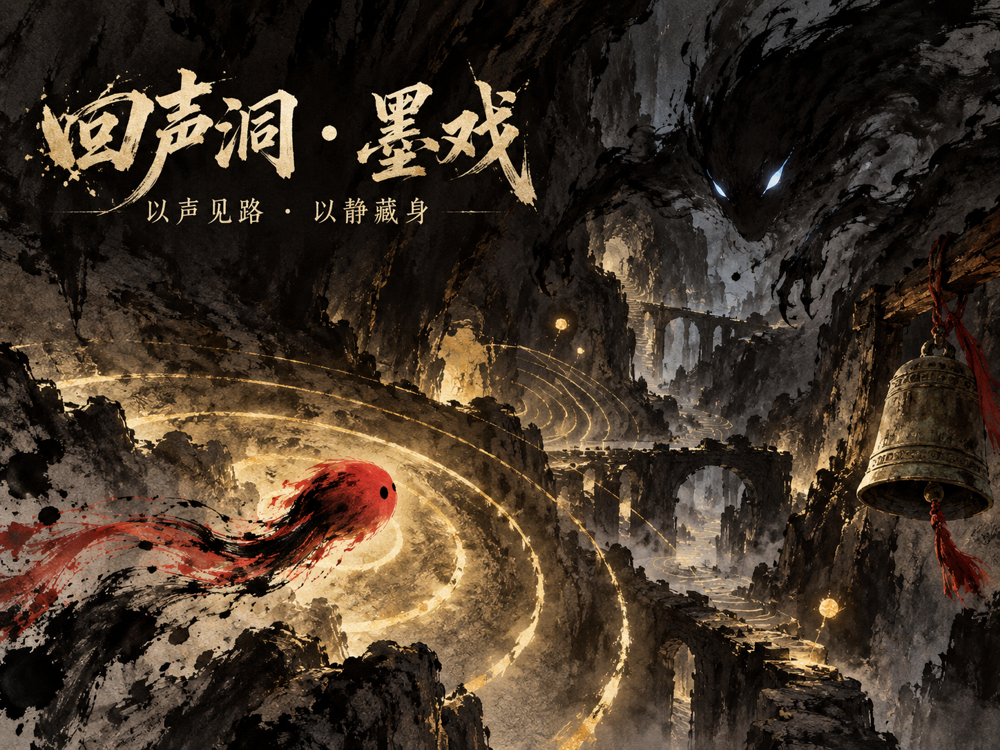

[简体中文](README.zh-CN.md) · [English](README.md) · [日本語](README.ja.md)

# Echo Cavern · Moxi / 回声洞 · 墨戏

## About the game

You are a drop of vermilion falling into an ink-dark world. In a cavern with almost no light, every echo of your footsteps reveals the rock walls—and can awaken the ink shadows hiding in the darkness.

*Echo Cavern · Moxi* is an ink-wash maze exploration game built around sonar. Move, ring the vermilion bell, dash, and throw ink-stone decoys to reveal paths for a moment. Collect golden ink spores scattered across five maze scrolls, then escape through the blank-space exit that opens. Ink shadows patrol, listen, and hunt: the more sound you make, the clearer the path and the closer the danger. Hand-drawn Chinese ink-painting assets, flowing ink effects, pentatonic music, and procedurally generated mazes come together in a game playable directly in desktop and mobile browsers.

## Play online

- GitHub Pages: <https://hbaopiqi.github.io/echo-cavern-moxi/>
- Sites mirror: <https://echo-cavern-moxi.hbaopiqi.chatgpt.site>

## Controls

| Platform | Move | Dash | Vermilion bell | Decoy | Pause |
| --- | --- | --- | --- | --- | --- |
| Desktop | WASD / arrow keys | Shift | Space | Q | Esc |
| Mobile | Left joystick | Dash button on the right | Bell button on the right | Decoy button beside the joystick | Menu button |

Headphones bring out the full experience. Click “入洞” (enter the cavern) first to allow the browser to play music and sound effects. The game uses Chinese interface labels; the controls above explain the main actions.

## Run locally

Open `index.html` directly to play. No backend application or dependency installation is required.

## Art and gameplay

- Hand-drawn ink-wash characters, mechanisms, and cavern assets
- Five procedurally generated maze scrolls
- Temporary path reveals from the bell, dashes, and decoys that gradually fade away
- Patrolling enemies and enemies that hunt by sound
- Combos, ratings, best-time records, and mobile touch controls
